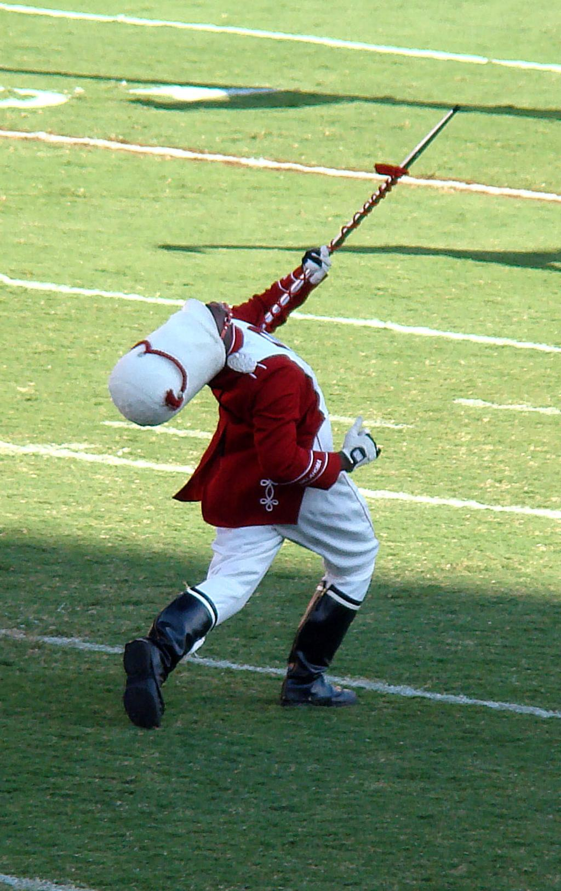
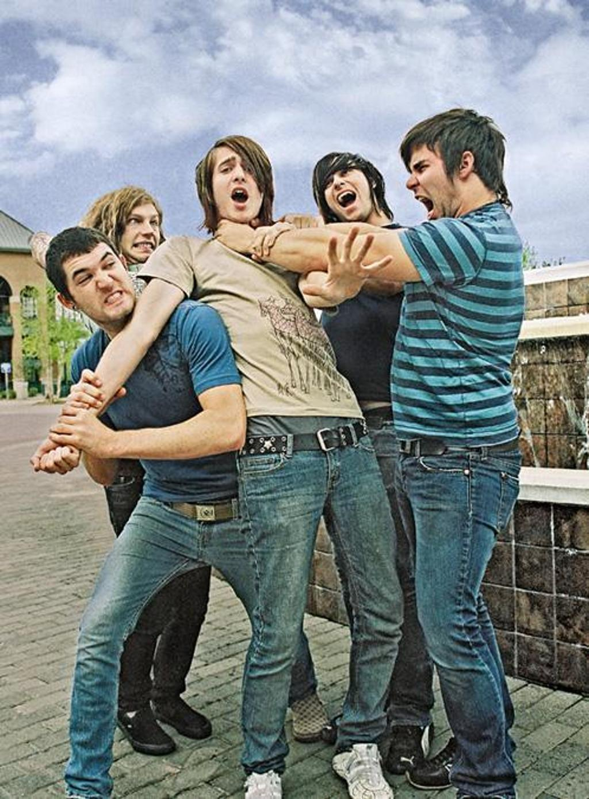
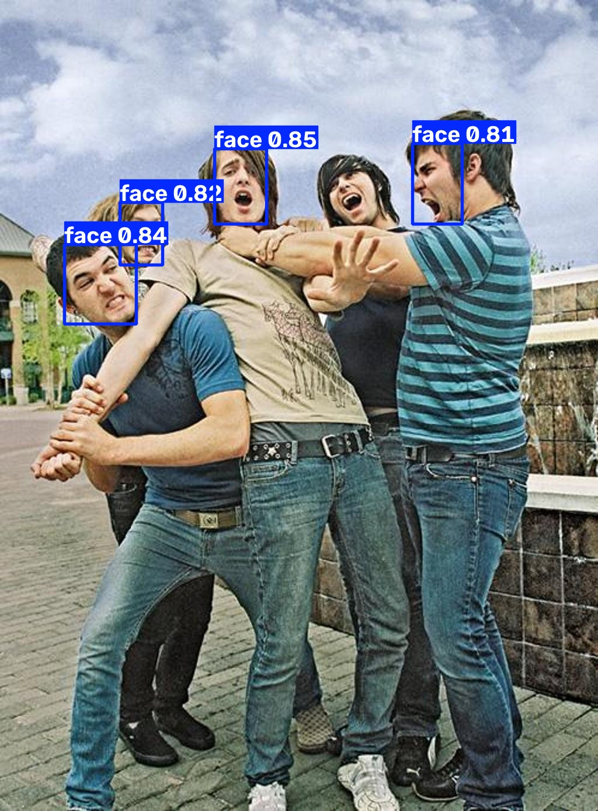

# YOLOv8 人脸检测（WIDER FACE 微调）

基于 **YOLOv8n** 微调的单类别人脸检测项目：从环境搭建、数据转换、训练调参，到批量推理、置信度阈值扫描与摄像头实时检测，全流程均已跑通并留有可复现的指标与产物。

| 项目 | 内容 |
|---|---|
| 任务 | 目标检测 · 单类别 `face` |
| 基础模型 | `yolov8n.pt`（COCO 预训练，迁移学习） |
| 数据集 | WIDER FACE train 划分，按「每图框数」分层抽样 · **4000 训练 / 400 验证** |
| **mAP@50** | **0.894** |
| **mAP@50-95** | **0.629** |
| Precision / Recall | 0.954 / 0.827 |
| 硬件 | NVIDIA RTX 4070 Laptop 8GB · Windows |

> 指标取自 `runs/detect/face_4000/results.csv` 最后一行（第 103 轮，训练配置为 150 轮 + patience 30 早停）。

## 效果样例

`samples/` 内是 10 组「原图 / 推理结果」对照（推理尺寸 960、conf 0.42、IoU 0.60）：

| 原图 | 推理结果 |
|---|---|
|  |  |
|  |  |

`samples/结果汇总.csv` 是对 **全部 100 张**验证图的评测明细，每张图跑 4 档置信度阈值（0.10 / 0.25 / 0.42 / 0.50），逐图给出：真实人脸数、检出框数、正确检出、漏检、错检 —— 可直接用来观察「阈值 ↔ 漏检/误检」的权衡。

## 训练产物（`runs/detect/face_4000/`）

| 文件 | 说明 |
|---|---|
| `weights/best.pt` | **推荐权重**（约 6 MB），所有脚本的默认模型 |
| `results.png` / `results.csv` | 损失与指标曲线、逐轮原始数值 |
| `BoxF1_curve.png` `BoxPR_curve.png` `BoxP_curve.png` `BoxR_curve.png` | F1 / PR / P / R 曲线 |
| `confusion_matrix.png` `confusion_matrix_normalized.png` | 混淆矩阵 |
| `val_batch0_labels.jpg` / `val_batch0_pred.jpg` | 验证批次「标注 vs 预测」对照 |
| `labels.jpg` `train_batch0.jpg` | 标注分布、训练批次可视化 |

## 仓库结构

```
yolov8-face-detection/
├── train.py                  训练入口（默认 150 轮 / batch 8 / imgsz 640 / 单卡 GPU 0）
├── predict.py                批量推理（默认读 datasets/mydata/images/val，imgsz 960 / conf 0.42 / IoU 0.60）
├── webcam.py                 摄像头实时检测（FPS 统计、按 s 截图保存）
├── batch_detect.py           通用批处理：递归子目录、导 CSV、导 YOLO 标签、按框裁剪人脸
├── infer_100.py              对 100 张验证图跑 4 档阈值并汇总出 samples/结果汇总.csv
├── check_env.py              环境自检（--full 会额外跑一次真实推理）
├── 激活yolo8环境.cmd           Windows 一键进入 conda 环境
├── 开始训练人脸模型.cmd         Windows 一键训练（可改轮数/batch/尺寸）
├── datasets/data.yaml        数据集配置（单类别 face）
├── runs/detect/face_4000/    最佳一次训练的完整产物
└── samples/                  推理样例与评测汇总
```

## 快速开始

```bash
# 1) 环境（Python 3.12 + CUDA 版 PyTorch）
conda create -n yolo8 python=3.12 -y && conda activate yolo8
pip install torch torchvision --index-url https://download.pytorch.org/whl/cu130
pip install -r requirements.txt

# 2) 自检（确认 GPU 可用）
python check_env.py --full

# 3) 用仓库自带权重直接推理
python predict.py --source samples/原图 --model runs/detect/face_4000/weights/best.pt

# 4) 摄像头实时检测
python webcam.py --source 0 --conf 0.40

# 5) 复现训练（需先准备好数据，见下）
python train.py --data datasets/data.yaml --epochs 150 --batch 8 --imgsz 640 --name face_4000
```

## 数据集

数据不随仓库分发。`datasets/data.yaml` 已按 YOLO 格式配好，把数据放到对应目录即可训练：

```
datasets/mydata/
├── images/train/   4000 张   ┐
├── images/val/      400 张   │  图片与标签文件名一一对应
├── labels/train/   4000 个   │  标签格式：<类别> <中心x> <中心y> <宽> <高>（0~1 归一化）
└── labels/val/      400 个   ┘
```

| 数据集 | 规模 | 说明 |
|---|---|---|
| WIDER FACE（train） | 4000 训练 / 400 验证 | 本项目实际训练所用；按每图框数分层抽样，保持与原划分一致的难度分布 |

## 主要训练超参

`model=yolov8n.pt` · `epochs=150` · `patience=30` · `batch=8` · `imgsz=640` · `optimizer=auto` · `lr0=0.002` · `cos_lr=true` · `close_mosaic=10` · `mosaic=0.8` · `seed=0` · `amp=true` · `workers=4`

完整记录见 `runs/detect/face_4000/args.yaml`。

## 实测环境

| 组件 | 版本 |
|---|---|
| Python | 3.12.14 |
| PyTorch / torchvision | 2.14.0+cu130 / 0.29.0+cu130 |
| Ultralytics | 8.4.161 |
| numpy / pandas / scipy | 2.5.3 / 3.0.6 / 1.18.1 |
| matplotlib / seaborn / pillow | 3.11.2 / 0.13.2 / 12.3.0 |
| 显卡 | RTX 4070 Laptop 8GB |

> `.cmd` 脚本内的环境路径（如 `D:\miniconda3\Scripts\activate.bat`）为作者本机路径，换机器请自行修改。

## 数据来源与声明

- 训练与样例图片来自 **WIDER FACE** 数据集，版权归原作者所有，仅用于学习与研究；如涉版权问题请联系删除。
- 权重 `best.pt` 为本项目微调产物，可自由用于测试；本项目仅提供代码与模型，不对使用后果负责。
